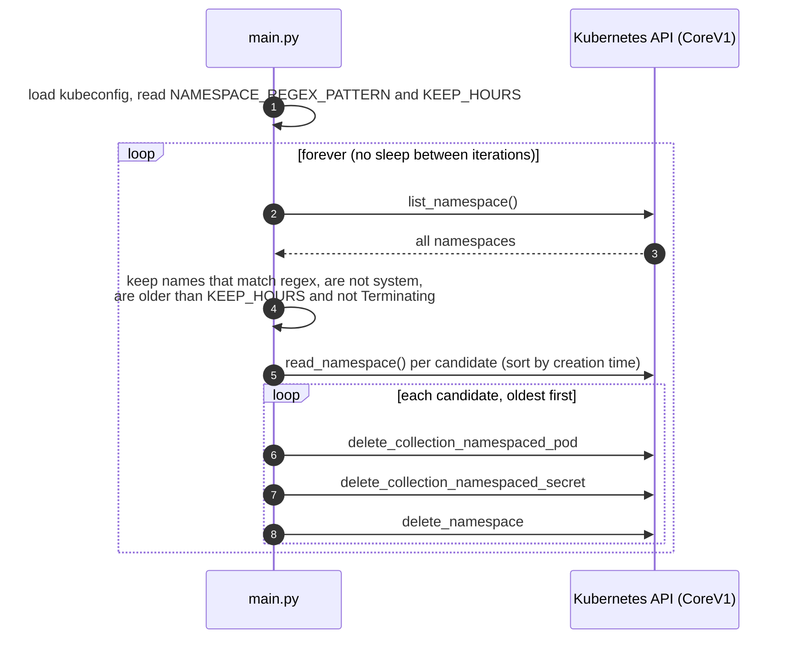

# Kubernetes Namespace Cleaner

A small Python loop that deletes Kubernetes namespaces whose name matches a regex and that are
older than a given number of hours, while never touching system namespaces.

## Description

Short-lived namespaces, such as per-branch "review app" environments created by CI, tend to pile up
in shared clusters. This script watches the cluster and removes the ones that match a naming
pattern once they reach a configurable age. It is meant for platform or DevOps engineers who want
a minimal, dependency-light cleanup job instead of a full operator.

## Features

- Selects namespaces by **regex** on the name (`re.match`, anchored at the start).
- Keeps namespaces younger than **`KEEP_HOURS`**.
- Never deletes `kube-system`, `kube-public`, `kube-node-lease` or `default`.
- Skips namespaces already in the `Terminating` phase.
- Deletes the oldest matching namespaces first.
- Before deleting a namespace, deletes its pods and secrets explicitly.
- Logs errors per namespace and keeps going.
- Ships with a Dockerfile.

## Architecture



## Requirements

- Python 3.6 or newer (the Docker image uses Python 3.7).
- The [`kubernetes`](https://pypi.org/project/kubernetes/) Python client.
- A kubeconfig whose current context can `list`, `get` and `delete` namespaces and
  `deletecollection` pods and secrets in the target namespaces.

## Installation and quick start

```bash
git clone https://github.com/Lapeyus/kubernetes-namespace-cleaner.git
cd kubernetes-namespace-cleaner

python3 -m venv .venv
source .venv/bin/activate
pip install kubernetes

# Try it against a test cluster first: it deletes namespaces immediately.
NAMESPACE_REGEX_PATTERN='^review-' KEEP_HOURS=24 python main.py
```

The script uses the current context of `~/.kube/config` (or `$KUBECONFIG`) and runs until you stop
it with Ctrl+C.

## Usage

Delete every `preview-*` namespace older than 6 hours:

```bash
NAMESPACE_REGEX_PATTERN='^preview-' KEEP_HOURS=6 python main.py
```

Run it as a container from your workstation, mounting your kubeconfig:

```bash
docker build -t namespace-cleaner .
docker run --rm \
  -e NAMESPACE_REGEX_PATTERN='^review-' -e KEEP_HOURS=24 \
  -v "$HOME/.kube/config:/root/.kube/config:ro" \
  namespace-cleaner
```

Note that kubeconfigs that rely on an exec credential plugin (for example
`gke-gcloud-auth-plugin`) also need that plugin inside the container.

## Repository structure

```text
.
├── main.py       # the whole cleaner: config, selection, deletion loop
├── dockerfile    # python:3.7 image with the kubernetes client, runs main.py
└── README.md
```

## Configuration

| Environment variable | Meaning | Default in code |
|---|---|---|
| `NAMESPACE_REGEX_PATTERN` | Regex matched against the start of each namespace name | `^review*` |
| `KEEP_HOURS` | Minimum age, in hours, before a matching namespace is deleted | `0` |

Be careful with the defaults: `^review*` means "starts with `revie` followed by any number of
`w`", so it matches any name starting with `revie`, and with `KEEP_HOURS=0` matching namespaces are
deleted as soon as they are seen. Set both variables explicitly. A pattern like `^review-` is
usually what you want.

No files are read other than the kubeconfig. Nothing needs to stay out of Git.

## Tests

There are no automated tests.

## Deployment

There are no Kubernetes manifests in the repository. The script calls `config.load_kube_config()`,
not `load_incluster_config()`, so running it as a pod requires mounting a kubeconfig (for example
from a Secret) or changing that line to use the in-cluster service account. A Deployment with a
service account bound to a ClusterRole for the permissions listed in [Requirements](#requirements)
would then work.

## Project status

**Experiment, inactive.** Three commits, all on 23 March 2023.

### Known limitations

- The main loop has **no sleep**, so it lists namespaces continuously and puts steady load on the
  API server. Add a `time.sleep(...)` at the end of the loop before running it for long.
- `MAX_NAMESPACES_TO_DELETE`, mentioned in earlier versions of this README, is **not implemented**.
- A `watch.Watch().stream(...)` object is created but never used.
- The `deleted_namespaces` counter is incremented but never reported.
- Uses `datetime.utcnow()`, which is deprecated in Python 3.12 and later.
- No dry-run mode: every match is deleted.

## License

No `LICENSE` file is included. Earlier versions of this README said the project is MIT licensed;
until a license file is added, default copyright applies.
